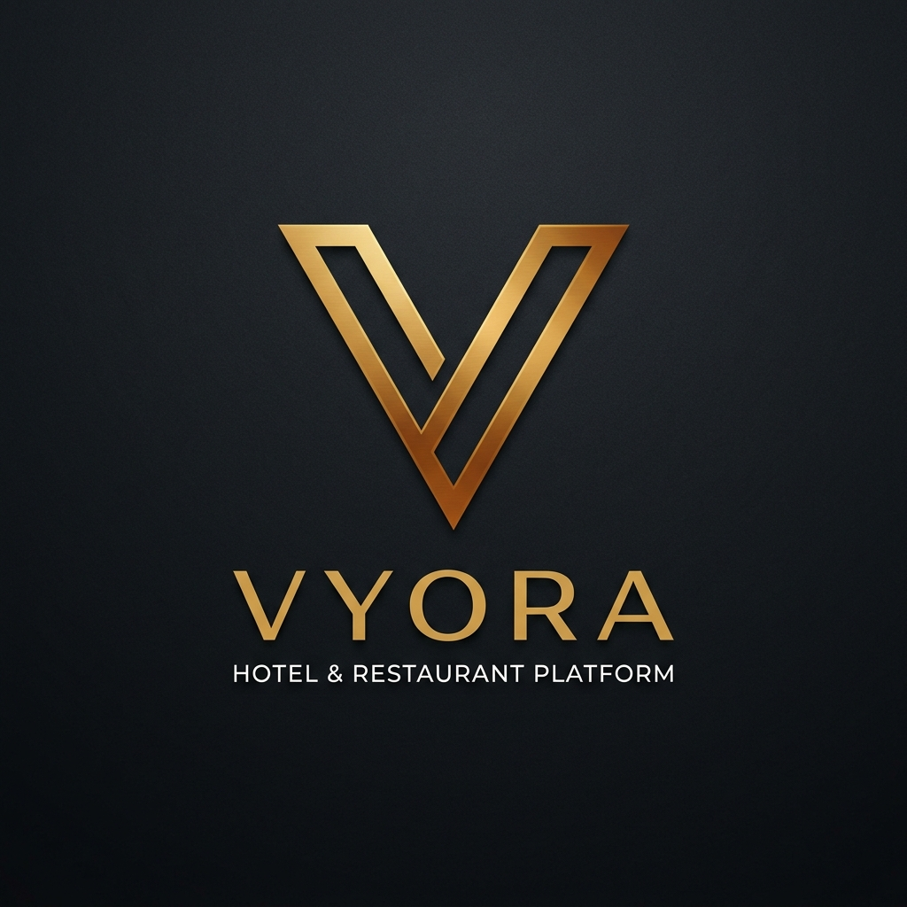

# Vyora — Unified Hospitality Operating System

  

  <strong>The modern, unified operating platform for Hotel Property Management (PMS), In-Room QR Services, Restaurant POS, Kitchen KDS, Team RBAC, and Cross-Business Dining Networks.</strong>

  
  
  
  
  

---

## 📖 Overview

**Vyora** is an all-in-one hospitality operating system engineered to bridge the gap between accommodation and dining. Designed from the ground up to support standalone restaurants, boutique hotels, multi-floor luxury resorts, and cross-business partner networks, Vyora eliminates fragmented software stacks by unifying front desk operations, kitchen workflows, guest portals, and billing under a single, cohesive ecosystem.

---

## 🌟 Key Modules & Features

### 1. 🏨 Hotel Property Management (PMS)
* **Live Room Status Board**: Real-time visual room inventory tracking status at a glance (**Available** 🟢, **Occupied** 🔵, **Turnover / Dirty** 🟠, and **Maintenance** 🔴).
* **1-Tap Guest Check-In & Check-Out**: Fast guest onboarding with name, phone, government ID recording, advance deposit tracking, and automatic room status assignment.
* **Unified Guest Folio Invoicing**: Automatic bill consolidation that merges room tariff, in-room dining meals, and housekeeping amenities into a single itemized guest folio.
* **Housekeeping & Concierge Dispatch Queue**: Real-time service board for room cleanings, extra towel/linens, water, luggage handling, and front-desk wake-up calls.

---

### 2. 📱 In-Room QR Guest Portal (`/room/{hotelId}/{roomNumber}`)
* **Zero App Download**: Guests scan the room's dynamic QR code with any smartphone camera to open the instant web portal.
* **HMAC-SHA256 Cryptographic Authentication**: Tamper-proof session tokens ensure guests can only access and order for their assigned room.
* **In-Room Dining Menu**: Complete digital menu with dish images, allergen tags, preparation times, and cooking instructions.
* **Live Order & Service Tracking**: Real-time progress indicators for meal preparation, room delivery, and housekeeping request fulfillment.
* **On-Demand Amenities**: Direct requests for toiletries, laundry pickup, room cleaning, wake-up calls, and taxi bookings.

---

### 3. 🍽️ Restaurant POS & Table QR Ordering (`/order/{ownerId}/{tableNumber}`)
* **Interactive Dine-In Menu**: Category filtering, instant search, dietary tags, and rich food imagery.
* **Kitchen Display System (KDS)**: Real-time kitchen Kanban order pipeline (**Pending** ➔ **Preparing** ➔ **Ready** ➔ **Completed**) with instant visual updates.
* **Waiter Call & Service Assistance**: 1-tap table call button that alerts staff instantly to table assistance or water requests.
* **Session-Based Table Billing**: Aggregates multiple order rounds from the same table into a single unified session bill.
* **Thermal Receipt Printing**: 1-click printable itemized POS receipts with subtotal, taxes, and grand totals formatted for thermal POS printers.

---

### 4. 🤝 Cross-Business Multi-Partner Network (`/dashboard/hotel/partner`)
* **Hotels Without In-House Kitchens**: Link nearby dining restaurants to fulfill room service food orders seamlessly.
* **Intelligent Kitchen Dispatch**: Partner restaurant kitchens automatically receive orders labeled with origin metadata (`🏨 [Hotel Name] • Room #[Number]`).
* **Unified Billing**: Orders placed through partner restaurants automatically charge to the guest's hotel room folio or table bill.

---

### 5. 👥 Team & Staff Role-Based Access Control (`/dashboard/staff`)
* **Granular Role Architecture**:
  - `FRONT_DESK`: Room assignments, guest check-in/out, folio settlements, and concierge dispatch.
  - `HOUSEKEEPING`: Room cleaning status updates, linen changes, and amenity deliveries.
  - `CHEF`: Kitchen Display System (KDS), dish availability controls (86'd out), and cooking updates.
  - `WAITER`: Table service requests, food delivery confirmation, and customer assistance.
  - `CASHIER`: Bill generation, payment settlement, and cash drawer management.
  - `MANAGER`: Comprehensive venue administration, catalog controls, reports, and staff management.
* **Quick 4-Digit PIN Access**: Fast employee terminal switching without full password entry.

---

### 6. 🛡️ Super Admin White-Label SaaS Platform (`/superadmin`)
* **Multi-Tenant Administration**: Manage and monitor all onboarded hotels, restaurants, and combo properties.
* **White-Label & Branding Customization**: Configure platform name, tagline, branding accents, default currency (INR `₹`, USD `$`, EUR `€`), and support contacts.
* **Subscription Tier Builder**: Build customizable SaaS subscription packages with table limits, room limits, and feature lists.
* **Payment Gateway Management**: Configure gateway modes (Manual / Invoicing, Stripe Connect, Razorpay) and SaaS platform commission fees.
* **Real-time Live Sync Engine**: Configure WebSockets / Pusher channel sync settings across the entire platform.

---

## 🎨 UI/UX & Design Standard

- **Apple-Inspired Design Tokens**: Strict typography, high-contrast light default palette with full dark mode toggle, and smooth cubic-bezier micro-animations.
- **Mobile-First 2-Column Responsive Layouts**: All dashboards, stat tiles, room cards, dish items, and employee directories adapt to a minimum 2-column grid on mobile devices.
- **High-Accessibility Touch Targets**: All interactive elements, buttons, and form inputs meet the minimum 44px touch target guidelines.

---

## 🔒 Security Architecture

- **Stateless JWT & Session Authentication**: Secure token verification for administrative, staff, and customer sessions.
- **Tamper-Proof Table & Room Signatures**: HMAC signatures embedded in QR codes prevent unauthorized or spoofed orders.
- **Strict API Rate Limiting**: Built-in protection against brute-force attacks and abuse.
- **Role-Based Middleware Gatekeeping**: Comprehensive request validation and policy enforcement across all API endpoints and Blade views.

---

## 📄 License

Vyora is licensed under the [MIT License](https://opensource.org/licenses/MIT).
